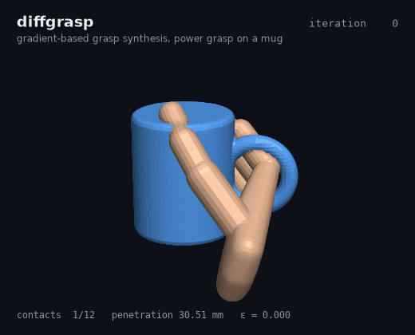
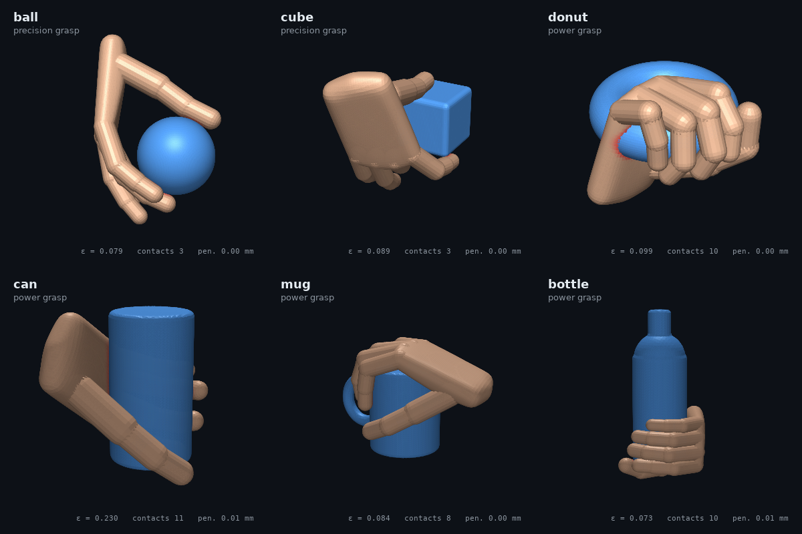
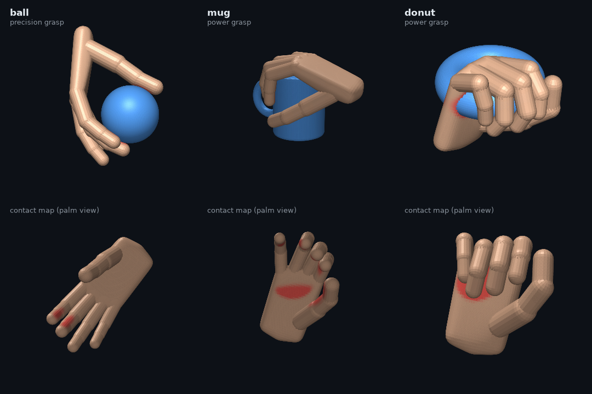

<h1 align="center">diffgrasp</h1>

<p align="center">
  <b>Differentiable grasp synthesis for a procedural 21-DOF human hand, in PyTorch.</b>
</p>

<p align="center">
  <a href="https://github.com/Dy07077/diffgrasp/actions/workflows/ci.yml"></a>
  
  
  
</p>

<p align="center"></p>

Describe an object as a signed distance function, and diffgrasp optimises dozens of hand poses in
parallel by gradient descent. The grasps it returns touch the surface, do not penetrate it, and can
resist any small disturbance under Coulomb friction. That last property is force closure, verified
independently with the Ferrari–Canny metric.

## Gallery

<p align="center"></p>

| Object | Grasp | Valid seeds | Best valid ε | Contacts | Penetration | Time (48 seeds) |
| --- | --- | ---: | ---: | ---: | ---: | ---: |
| ball | precision | 98% | 0.079 | 3 | 0.00 mm | 20 s |
| cube | precision | 33% | 0.089 | 3 | 0.00 mm | 22 s |
| donut | power | 71% | 0.099 | 10 | 0.00 mm | 38 s |
| can | power | 33% | 0.230 | 11 | 0.01 mm | 38 s |
| mug | power | 27% | 0.084 | 8 | 0.00 mm | 37 s |
| bottle | power | 38% | 0.073 | 10 | 0.01 mm | 41 s |

A grasp counts as **valid** when it is force-closure with μ = 0.5 (Ferrari–Canny ε > 0), has at least
three contacts within 2 mm of the surface, and penetrates less than 1 mm. ε measures the largest
disturbance wrench the grasp can resist per unit contact force, with torques divided by the object
radius. Times were measured on a laptop CPU. Regenerate the table with `python examples/gallery.py`.

<p align="center"></p>

## How it works

**Hand.** A kinematic tree with 21 joint angles: four per finger (MCP abduction and flexion, PIP,
DIP) and five for the thumb. The thumb's CMC joint includes the axial rotation that lets its pad
face the fingers in opposition. A sigmoid maps unconstrained parameters into anatomical joint
limits, and the wrist pose uses the continuous 6D rotation representation. Phalanges are capsules
and the palm is a smoothed convex hull. Everything is PyTorch, so every quantity is differentiable.

**Objects.** Exact signed distance functions for spheres, boxes, cylinders, tori and their unions.
Surface normals come from autograd.

**Energy.** For a batch of poses $q$:

$$
E(q) = w_c\sum_k \rho\big(d(c_k)\big) + w_a\sum_k\big(1+n^{\text{hand}}_k\!\cdot n^{\text{obj}}_k\big)
     + w_p\sum_j \big(\delta_j+\delta_j^2\big) + w_f\,E_{\text{closure}} + w_s E_{\text{self}} + w_r\lVert\theta-\theta_0\rVert^2
$$

The terms pull contact points $c_k$ (finger pads, palm) onto the surface with a smooth-L1 penalty
$\rho$, face the pads towards the object, push every hand-surface sample $s_j$ out of the object
(its penetration depth is $\delta_j=\mathrm{relu}(-d(s_j))$ in centimetres),
reward force closure, keep fingers out of each other and the palm, and keep joints near a relaxed
posture.

**Differentiable force closure.** Each contact's friction cone is linearised into primitive
wrenches $W$. The grasp resists every disturbance of size $\delta$ along the 12 directions
$\pm\delta e_i$ exactly when those points lie inside $\mathrm{conv}(W)$. diffgrasp computes each
squared distance $\min_{\lambda\in\Delta}\lVert W\lambda-p_i\rVert^2$ with pairwise Frank–Wolfe, and
differentiates it through Danskin's theorem, $\nabla_W = 2(W\lambda^\ast-p_i)\lambda^{\ast\top}$.
No autograd through the inner solver is needed. Contacts that are not touching have their cones
faded by $e^{-(d/3\,\mathrm{mm})^2}$, so the optimiser cannot "close" a grasp with fingers in mid-air.

**Optimiser.** Each seed starts from a pre-shaped opposition posture whose contact centroid sits at
a random point inside the object. All seeds then run together through Adam with cosine step decay
and annealed exploration noise. Seeds are ranked by energy and the best valid grasp is reported.

## Design notes

Getting from "the optimiser runs" to valid grasps took five fixes, each found by isolating one term
at a time:

1. **Force balance with unit normals is too strict.** The estimator of Liu et al. needs contact
   normals that sum to zero, which forces three fingers 120° apart. A natural thumb-against-two-fingers
   pinch can never satisfy that, so the optimiser pulled fingers off the surface to fake it. The
   wrench-hull test above accepts any grasp that friction can stabilise.
2. **The thumb could not oppose.** A 2-DOF thumb base left the thumb pad facing the wrist. Adding
   CMC axial rotation raised the pad-to-target alignment of the pre-grasp from 0.6 to 0.96.
3. **Contact points sat 3% inside the capsules.** A perfect touch therefore implied 0.25 mm of
   penetration, so the two terms could never both reach zero.
4. **A quadratic contact penalty never quite closes.** Its pull vanishes near the surface. The
   smooth-L1 exact penalty keeps a constant pull.
5. **Approaching from outside finds one-sided grasps.** Starting with the object inside a
   pre-shaped aperture finds opposition grasps.

## Quick start

```bash
git clone https://github.com/Dy07077/diffgrasp && cd diffgrasp
pip install -e ".[dev]"
pytest -q                          # 38 tests, ~10 s
cd examples && python gallery.py   # writes assets/gallery.png and assets/results.json
```

```python
import diffgrasp as dg

hand, mug = dg.HandModel(), dg.make_object("mug")
opt = dg.GraspOptimizer(hand, mug, grasp_type="power", n_seeds=48)
res = opt.run(800)
report = dg.evaluate(hand, mug, res.pose, opt.contacts)
best = max((r for r in report if r["valid"]), key=lambda r: r["epsilon"])
print(best)   # {'epsilon': ..., 'n_contacts': ..., 'penetration_mm': ..., 'valid': True}
```

## Project layout

```text
diffgrasp/
├── hand.py       procedural hand: kinematics, capsule geometry, contact candidates, meshes
├── objects.py    signed distance functions and marching-cubes meshes
├── energy.py     the grasp energy and grasp types (precision, fingertips, power)
├── wrench.py     friction-cone wrenches and the differentiable force-closure surrogate
├── optimize.py   batched optimiser, pre-grasp initialisation, evaluation
├── quality.py    Ferrari–Canny epsilon metric (scipy ConvexHull)
├── rotation.py   6D rotations, elementary rotations, Rodrigues
└── render.py     matplotlib renderer with contact heat maps
```

## Limitations

- Grasps are checked quasi-statically with force closure. They are not simulated under gravity or
  shaking yet; a physics check, for example with [softfem](https://github.com/Dy07077/softfem), is
  the natural next step.
- The hand is a capsule mannequin, not a scanned model such as MANO. The optimiser only needs
  differentiable contact points and surface samples, so another hand model can be swapped in.
- Contacts are point contacts with a fixed friction coefficient. Soft-finger contacts would add
  torsional friction and make two-finger pinches force-closure.

## References

1. C. Ferrari, J. Canny. *Planning Optimal Grasps.* ICRA 1992.
2. T. Liu, Z. Liu, Z. Jiao, Y. Zhu, S.-C. Zhu. *Synthesizing Diverse and Physically Stable Grasps With Arbitrary Hand Structures Using Differentiable Force Closure Estimator.* IEEE RA-L, 2021.
3. Y. Zhou, C. Barnes, J. Lu, J. Yang, H. Li. *On the Continuity of Rotation Representations in Neural Networks.* CVPR 2019.
4. S. Lacoste-Julien, M. Jaggi. *On the Global Linear Convergence of Frank-Wolfe Optimization Variants.* NeurIPS 2015.
5. J. Romero, D. Tzionas, M. J. Black. *Embodied Hands: Modeling and Capturing Hands and Bodies Together.* SIGGRAPH Asia 2017.

## License

MIT © 2026 Ding Yuan
